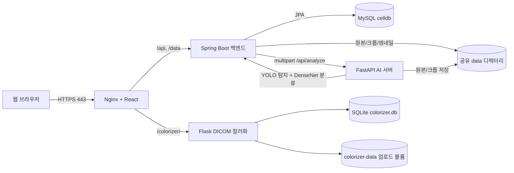

# C.E.L.L. 시스템 정의서 작성 근거 자료

- 조사 기준일: 2026-09-29 (Asia/Seoul)
- 조사 대상 저장소: `C:\DEV`
- 양식 원본: `C:\Users\ISW_1\Desktop\2026_졸업작품 산출물 개정\2026-개정-D01-시스템정의서.hwp`
- 판정 표기: **[구현 확인]**, **[문서상 계획]**, **[추정]**, **[확인 불가]**
- 보안 원칙: 실제 비밀번호, 비밀키, 토큰, 학생 개인정보 및 운영 데이터 값은 기록하지 않았다.

## 조사 방법과 범위

1. HWP 원본을 수정하지 않고 HWP 5 내부 레코드를 읽어 텍스트·HTML·XML 임시 변환본을 만들었다. 원본 서명은 HWP 5 OLE이고 파일 버전은 5.1.1.0이다. 두 번째 표가 들어 있는 문단에는 원본 레코드상 `new-page=1`이 있으므로 문서는 실제 2쪽 구성이다.
2. 저장소의 문서, 프런트엔드, Spring 백엔드, FastAPI AI 서버, DICOM 컬러화 서비스, Docker/Nginx 설정, SQL, 테스트를 정적 조사했다.
3. 실행 중인 컨테이너와 MySQL 스키마는 읽기 전용으로 확인했다. 2026-09-29 기준 5개 서비스가 실행 중이었고 AI 서버·컬러화·MySQL은 health check가 `healthy`였다.
4. 테스트는 운영 데이터를 사용하지 않는 격리 환경에서 실행했다. 결과는 4.8절에 기록했다.

---

# 1. 양식 구조 분석

## 1.1 원본 페이지·기본 서식

| 구분 | 원본에서 확인한 내용 | 판단 근거/주의 |
|---|---|---|
| 파일 형식 | HWP 5.1.1.0, 압축 사용, 암호·DRM·전자서명 없음 | 원본 `FileHeader` 내부 레코드 |
| 페이지 | A4 세로, 210×297 mm, 2쪽 | `PageDef`: 59528×84188 HWPUNIT, orientation=portrait. 두 번째 표 문단 `new-page=1` |
| 여백 | 좌·우·위·아래 약 20 mm, 머리말·꼬리말 기준 약 10 mm | `PageDef` left/right/top/bottom=5668~5669, header/footer=2836. HTML 변환본도 좌우 20 mm로 해석함 |
| 표 | 1쪽 1개(가로 약 169.97 mm), 2쪽 1개(가로 약 168.97 mm) | 원본 `TableControl`; 변환 HTML 치수 |
| 표 선/셀 | 검은 실선, 셀 안쪽 여백 약 0.5 mm, 세로 가운데 정렬이 주로 사용됨 | 원본 `BorderFill`, `TableCell`; HTML 변환 시 1px 실선으로 표현됨. 1px는 변환 결과이므로 HWP 선 굵기와 완전히 같다고 단정하지 않음 |
| 제목 | `시스템 정의서(프로젝트 요약서)`, 가운데 정렬, 휴먼명조 계열, 16 pt, 굵게, 줄 간격 160% | 원본 `CharShape 0`, `ParaShape 1`; 글꼴 내부명은 변환기의 기본 글꼴 매핑을 함께 확인함 |
| 표의 큰 제목 | `작품(주제)에 대한 요약`, `작품(주제)에 대한 요약 (계속)`: 가운데 정렬, 휴먼명조 계열, 12 pt, 굵게 | `CharShape 58`, `ParaShape 1` |
| 일반 표 제목 | 작품명, 책임자, 개발기간 등: 주로 휴먼명조 계열 12 pt, 보통, 가운데 정렬 | `CharShape 59`, `ParaShape 1` |
| 세부 항목 제목 | 작품 설명, 사용자 유형 등: 주로 휴먼명조 계열 11 pt, 가운데 정렬 | `CharShape 60/66`, `ParaShape 65/66/71` |
| 예시 본문 | 주로 맑은 고딕 또는 휴먼고딕 계열 10 pt, 파란색(`#0000e1` 계열), 일부 굵게, 양쪽 정렬, 줄 간격 160~180% | `CharShape 67~72`, `ParaShape 67~73`. 색상·글꼴은 원본 내부 레코드에서 확인했으나 표시 결과는 설치 글꼴에 따라 달라질 수 있음 |
| 메타데이터 | 과거 자체평가보고서 양식 제목과 2004년 생성 정보가 남아 있음 | `HwpSummaryInfo`. 현재 양식의 작성 내용으로 사용하면 안 됨 |

글꼴 이름은 원본 내부 `FaceName`에 휴먼명조·휴먼고딕·맑은 고딕 계열이 기록되어 있고, 영문 대체 글꼴도 별도로 존재한다. 다만 이 PC에는 한글 프로그램이 설치되어 있지 않아 한글 편집 화면의 실제 렌더링을 직접 대조하지 못했다. 따라서 **글꼴 이름·크기·굵기·정렬은 원본 내부 레코드 확인**, **CSS의 1px 선과 일부 mm 계산은 변환본 추정**으로 구분한다.

## 1.2 양식의 실제 항목 순서

### 1쪽

| 순서 | 원본 항목/문구 | 셀 구조와 공간 | 요구 정보 | 예시/작성 구분 |
|---:|---|---|---|---|
| 1 | `시스템 정의서(프로젝트 요약서)` | 표 위 제목 1행 | 문서 제목이며 수정 대상 아님 | 고정 문구 |
| 2 | `팀 번호(  -  )` | 제목 아래 우측 정렬 1행 | 팀 번호 | 빈칸 작성 |
| 3 | `작품명(주제)` / `(국문)` / `(영문)` | 왼쪽 제목 33.29 mm, 오른쪽 각 136.68×9.02 mm, 2행 | 국문·영문 작품명 각 1줄 | `(국문)`, `(영문)`은 안내 표지이며 뒤에 작성 |
| 4 | `책 임 자` / `성 명` / `소 속` / `학 번` | 책임자 제목 33.29×23.60 mm, 세부 제목 28.28×7.87 mm, 입력칸 약 108.41 mm | 팀 책임자의 성명·소속·학번 | 모두 빈칸 작성 |
| 5 | `개발기간` | 제목 33.29 mm, 입력칸 136.68×10.53 mm | 시작일과 종료일 | `20 년 월 일 ～ 20 년 월 일` 형식을 채움 |
| 6 | `참여학생` / `학번` / `이름` / `전공` | 머리행 포함 4행, 즉 학생 입력행 3개. 학번 약 51.24 mm, 이름 37.23 mm, 전공 48.21 mm | 책임자 포함 여부는 양식만으로 불명확. 최대 3명 정보 | 머리행 고정, 아래 3행 작성 |
| 7 | `지도교수` | 제목 33.29 mm, 입력칸 136.68×10.53 mm | 지도교수 성명 | 빈칸 작성 |
| 8 | `작품(주제)에 대한 요약` | 표 전체 폭, 높이 약 10.86 mm | 아래 요약 영역의 구역 제목 | 고정 문구 |
| 9 | `작품 설명` | 제목칸 약 34.07 mm, 본문칸 약 135.90×23.84 mm | 시스템이 무엇인지 2~3문장 | 파란 예시 `작품 OOO은 … 스마트폰용 앱이다.`를 삭제하고 작성 |
| 10 | `사용자 유형` | 제목칸 약 34.07 mm, 본문칸 높이 약 36.27 mm | 주요·보조·관리 사용자 목록과 간단한 역할 | 파란 예시 3개 항목을 삭제하고 작성. 3~5개 짧은 항목 적합 |
| 11 | `운영개념` | 제목칸 약 34.07 mm, 본문칸 높이 약 25.11 mm(왼쪽 병합셀 표시는 약 50.30 mm) | 시스템이 어디서 구동되고 어떤 서버/외부 시스템과 연결되는지 | 파란 번호 예시를 삭제하고 2~4개 번호 문장 작성 |

### 2쪽

| 순서 | 원본 항목/문구 | 셀 구조와 공간 | 요구 정보 | 예시/작성 구분 |
|---:|---|---|---|---|
| 12 | `작품(주제)에 대한 요약 (계속)` | 전체 폭 168.97×9.53 mm | 1쪽 요약의 계속 | 고정 문구 |
| 13 | `작품의 주요 기능` | 제목칸 33.57 mm, 본문칸 135.40×42.45 mm | 사용자 관점 핵심 기능 5~8개 | 주가 앱 예시 5개를 모두 삭제하고 작성 |
| 14 | `기타 개발시 고려사항` | 제목칸 33.57 mm, 본문칸 135.40×32.74 mm | 표준, 보안, 호환성, 데이터·운영 제약 | 안드로이드/N-Screen 예시를 삭제하고 3~5개 짧은 항목 작성 |
| 15 | `선행기술 조사 분석` | 제목칸 33.57 mm, 본문칸 135.40×113.65 mm | 특허·논문·상용 SW·오픈소스 중심의 비교 분석 | `<특허, 논문…오픈소스 분석을 진행합니다.>`는 작성 안내 문구. 가장 넓은 칸으로 약 12~18줄 가능 |
| 16 | `Key Words (5개) :` | 전체 폭, 높이 약 17.11 mm | 정확히 5개 키워드 | 안드로이드·주가 관련 파란 예시를 삭제하고 작성 |
| 17 | `지도 교수` / `(서명)` | 제목칸 약 39.28 mm, 서명칸 약 129.70×10.41 mm | 지도교수 서명 | 성명/서명은 학생이 임의 작성하지 말고 확인 필요 |

### 학생이 직접 알려줘야 하는 정보

**[확인 불가]** 팀 번호, 책임자 성명·소속·학번, 참여학생 최대 3명의 학번·이름·전공, 개발 시작일·종료일, 지도교수 성명·서명은 저장소와 양식에서 확인되지 않는다. 별도의 제출일 칸은 이 양식에 존재하지 않는다.

---

# 2. 시스템 한눈에 보기

| 항목 | 조사 결과 | 판정·근거 |
|---|---|---|
| 공식 표기 | `C.E.L.L. Platform` | **[구현 확인]** `README.md:1`, `frontend/index.html:6`, `frontend/src/pages/LoginPage.jsx:61` |
| 영문 설명 | `Hierarchical Human-in-the-Loop (HITL) Labeling Platform for WBC Dataset Construction and Education` | **[추정]** 공식 설명 후보로 `README.md:3`에 적혀 있고 주요 기능은 현재 코드와 부합하지만, 화면 코드에서 이 문구 자체를 공식 명칭으로 표시하지는 않음 |
| C.E.L.L. 약어 뜻 | 각 알파벳을 풀어 쓴 명칭은 없음 | **[확인 불가]** 저장소 전체 검색에서 위 영문 설명 외 별도 acronym 정의 없음. 임의 확장 금지 |
| 한 문장 소개 | 교수/전문가가 혈액도말 이미지를 AI로 세포 단위 탐지·분류해 과제를 만들고, 학생의 분류 답안과 전문가 GT를 축적·분석하는 웹 기반 HITL 교육·데이터 구축 플랫폼 | **[구현 확인]** 여러 구현을 한 문장으로 요약: `TaskService.java:69-85`, `StudentPage.jsx:525-700`, `StatsService.java:31-137` |
| 주요 사용자 | 학생(STUDENT), 교수/전문가(EXPERT), 관리자(ADMIN); DICOM 컬러화 서비스는 별도 자체 계정 사용자 | **[구현 확인]** `Role.java:7-15`, `App.jsx:33-45`, `컬러화POC/app.py:1276-1322` |
| 핵심 기능 | 과제 생성/마감, YOLO 탐지+DenseNet 분류, 학생 6종 분류, GT 확정·수정, 진단평가, 통계·혼동행렬·오답 복습, VIA JSON/ZIP 라벨 교환, 사용자·동물 종 관리, 독립 DICOM 컬러맵/ROI 작업 | **[구현 확인]** 아래 상세 조사 참조 |
| 주요 기술 | React 18.3.1, Vite 5.4.21, Spring Boot 3.3.5/Java 17, JPA, Spring Security/JWT, FastAPI, Ultralytics YOLOv8, PyTorch DenseNet-201, MySQL 8, Flask/pydicom/SQLite, Docker Compose, Nginx/TLS | **[구현 확인]** `frontend/package-lock.json:1759-1762,1931-1934`, `backend/build.gradle:1-33`, `ai-server/app/services/model_loader.py:32-47`, `docker-compose.yml:1-87` |
| 배포 구조 | 외부에는 Nginx의 80/443만 노출. `/api`, `/data`는 Spring으로, `/colorizer/`는 독립 Flask 서비스로 프록시. MySQL·AI·컬러화는 Compose 내부 네트워크 | **[구현 확인]** `frontend/nginx.conf:1-60`, `docker-compose.yml:16-83` |
| 현재 구현 상태 | 주 흐름과 DICOM 서비스는 구현됨. AI 재학습, 학생 투표 기반 pseudo-label posterior, 종별 세포 클래스 관리는 미완성/향후 계획 | **[구현 확인]** 주 흐름과 DICOM 서비스. **[문서상 계획]** 미완성 항목: `retrain_router.py:26-45`, `PseudoLabelService.java:11-18`, `SpeciesDataSettings.jsx:162-164` |

## 개발 배경·문제 정의의 근거 한계

- **[구현 확인]** 저장소는 WBC 데이터셋 구축과 교육을 동시에 목표로 한다고 명시한다(`README.md:1-3`).
- **[추정]** 구현 흐름으로 보아 해결하려는 문제는 (1) 혈액도말에서 세포를 수작업으로 잘라 과제를 만드는 비용, (2) 다수 학생 답안과 전문가 정답의 통합 관리, (3) 어려운 세포와 학생별 오분류 패턴 파악, (4) 확정 라벨을 재학습 데이터로 환류하는 과정의 단절이다. 이는 `TaskService.java:74-85`, `StatsService.java:82-137`, `CropService.java:62-80`에 근거한 해석이며 프로젝트 제안서의 공식 문제 정의는 아니다.
- **[확인 불가]** 실제 수업명, 대상 학과/학년, 사용자 인터뷰, 기존 업무 시간, 데이터 규모 목표, 정확도·시간 절감 목표는 자료에 없다. 수치화하면 안 된다.

---

# 3. 양식의 각 항목에 넣을 내용 대응표

아래 문안은 개인정보 항목을 제외하고 현재 자료에서 옮겨 쓸 수 있는 후보이다. **[추정]** 문안은 반드시 학생 확인 후 사용한다.

## 3.1 기본 정보 영역

| 양식 항목 | 짧은 문안 | 상세/작성 지침 | 근거 |
|---|---|---|---|
| 팀 번호 | `[학생 입력]` | 저장소에서 확인 불가 | **[확인 불가]** |
| 작품명(국문) | `C.E.L.L. 백혈구 데이터 구축·교육 플랫폼` | 코드에 공식 국문명이 없으므로 이 문안은 설명형 번역 후보일 뿐이다. 확정 전 팀의 공식 국문명 확인 필요 | **[추정]** `README.md:1-3` |
| 작품명(영문) | `C.E.L.L. Platform` | 공간이 허용되면 둘째 줄 또는 괄호에 `Hierarchical Human-in-the-Loop (HITL) Labeling Platform for WBC Dataset Construction and Education` 추가 | **[구현 확인]** 저장소의 현재 README와 화면 메타데이터에서 확인: `README.md:1-3`, `frontend/index.html:6` |
| 책임자 성명/소속/학번 | `[학생 입력]` | 팀 대표자 정보 | **[확인 불가]** |
| 개발기간 | `[YYYY. MM. DD. ～ YYYY. MM. DD.]` | Git 기록만으로 공식 개발기간을 확정하지 말 것 | **[확인 불가]** |
| 참여학생 | `[학번 / 이름 / 전공]` 최대 3행 | 책임자를 중복 기입하는지는 학과 지침 확인 필요 | **[확인 불가]** |
| 지도교수 | `[학생 입력]` | 마지막 서명 칸과 동일 인물인지 확인 | **[확인 불가]** |

## 3.2 작품 설명

**짧은 문안(좁은 칸용)**

> C.E.L.L.은 혈액도말 이미지에서 백혈구를 AI로 탐지·분류해 과제를 생성하고, 학생 답안과 전문가 정답을 비교·분석하여 교육과 데이터셋 구축을 지원하는 웹 플랫폼이다. 별도 DICOM 작업공간에서는 영상 명암 정규화, 컬러맵 비교와 ROI 라벨링을 지원한다.

**상세 문안**

> C.E.L.L. Platform은 교수·전문가가 혈액도말 이미지를 업로드하면 YOLOv8로 세포 영역을 탐지하고 DenseNet-201로 6개 세포 클래스를 예측하여 분류 과제를 생성하는 웹 시스템이다. 학생은 도말 이미지와 세포 크롭을 보며 답안을 제출하고, 시스템은 전문가가 확정한 Ground Truth 또는 진단평가 데이터셋의 정답과 비교하여 정확도·혼동행렬·오답 복습 정보를 제공한다. 관리자는 계정, 학생 사전 명단, 도말·크롭 및 라벨 상태를 관리한다. 같은 사이트의 독립 DICOM 컬러화 서비스는 계정별 작업 저장, 정규화·컬러맵, ROI, PNG/JPG/VIA 내보내기를 제공한다.

근거: **[구현 확인]** `backend/src/main/java/com/cell/platform/service/TaskService.java:69-85`, `ai-server/app/services/pipeline.py:6-26`, `frontend/src/pages/StudentPage.jsx:525-700`, `컬러화POC/README.md:1-3,21-30`.

## 3.3 사용자 유형

**짧은 문안**

> - 주요 사용자: 학생 — 과제·진단평가 수행, 결과·오답 복습, 문제 세포 신고  
> - 주요 사용자: 교수/전문가 — 과제 생성, GT 확정, 통계·혼동행렬 확인, 진단평가 생성  
> - 관리자 — 사용자 승인·상태, 학생 명단, 전체 이미지·라벨·통계 관리  
> - 보조 사용자: DICOM 작업 사용자 — 개인 작업공간에서 컬러맵·ROI 저장 및 내보내기

**상세 근거**

- 학생 경로와 역할 제한: **[구현 확인]** `frontend/src/App.jsx:33-45`, `StudentPage.jsx:395-460`.
- 교수/전문가 4개 탭: **[구현 확인]** `ExpertPage.jsx:825-830`.
- 관리자 4개 탭과 사용자 관리: **[구현 확인]** `AdminPage.jsx:436-441,1092-1233`.
- 컬러화는 CELL JWT를 공유하지 않고 자체 계정·세션 사용: **[구현 확인]** `컬러화POC/app.py:1245-1322`, `docker-compose.yml:53-65`.

## 3.4 운영개념

**짧은 문안**

> 1. 사용자는 웹 브라우저에서 HTTPS로 접속하며 역할에 따라 학생·전문가·관리자 화면으로 이동한다.  
> 2. Nginx가 React 화면을 제공하고 API/이미지 요청을 Spring 백엔드로 전달하며, 백엔드는 MySQL과 파일 저장소를 관리하고 AI 추론을 FastAPI 서버에 요청한다.  
> 3. DICOM 컬러화 기능은 같은 도메인의 `/colorizer/`에서 독립 Flask·SQLite 서비스로 운영된다.

근거: **[구현 확인]** `frontend/src/App.jsx:11-23,27-50`, `frontend/nginx.conf:1-60`, `docker-compose.yml:1-87`, `README.md:18-26`.

## 3.5 작품의 주요 기능

**짧은 문안(양식 칸 권장 7개)**

> - 혈액도말 다중 업로드 및 AI 기반 세포 탐지·6종 분류 과제 생성  
> - 학생별 세포 분류 답안 저장, 진행률 표시, 마감 기반 제출 잠금  
> - 전문가 GT 확정·수정과 VIA JSON/ZIP 라벨 입출력  
> - 정확도, 투표 분포, 오류율, 학생별 누적 혼동행렬 및 오답 복습  
> - 클래스 분포를 지정하는 GT 기반 진단평가 생성·즉시 채점  
> - 사용자 승인·비활성화, 학생 사전 명단 및 동물 종 관리  
> - DICOM 정규화·컬러맵·ROI 저장과 PNG/JPG/VIA 일괄 내보내기

**상세 근거**

- 과제 생성: `ExpertPage.jsx:748-779,833-947`, `TaskService.java:115-157`.
- AI 처리: `analyze_router.py:12-34`, `detector.py:17-55`, `classifier.py:17-49`.
- 학생 답안/마감 규칙: `SubmissionService.java:57-89,344-427`.
- GT·통계: `CropService.java:68-80`, `StatsService.java:31-137`.
- 진단평가: `DiagnosticTaskService.java:31-109`, `ExpertPage.jsx:1720-1798`.
- 관리: `AdminPage.jsx:1092-1233`, `AnimalSpeciesService.java:49-120`.
- DICOM: `컬러화POC/app.py:1493-1801`, `dicom_processing.py:159-280`.

## 3.6 기타 개발시 고려사항

**짧은 문안**

> 1. 의료·교육 이미지와 계정 정보를 다루므로 HTTPS, 접근 권한, 비밀번호 해시, 비밀값 분리와 백업 정책을 유지해야 한다.  
> 2. AI 가중치와 원본·크롭 파일은 DB 메타데이터와 함께 일관되게 백업·복구해야 한다.  
> 3. DICOM 압축 코덱·메타데이터 차이와 대용량 파일을 고려하고, 컬러화 결과는 의료적 판단을 대체하지 않음을 명시해야 한다.  
> 4. YOLOv8 등 오픈소스의 배포 라이선스를 확인하고, 현재 권한 설정과 테스트 불일치를 배포 전 보완해야 한다.

근거: **[구현 확인]** `frontend/nginx.conf:12-22`, `SecurityConfig.java:29-90`, `docker-compose.yml:5-65`, `컬러화POC/README.md:41-45`, `dicom_processing.py:71-101`. 권한·테스트 문제는 5.2절 참조.

## 3.7 선행기술 조사 분석

이 칸은 저장소만으로 완성할 수 없다. 특허 검색·상용 제품 비교를 수행했다는 문서나 결과가 없으므로 완료된 조사처럼 쓰면 안 된다.

**현재 근거로 쓸 수 있는 초안**

> 본 시스템은 객체 탐지용 Ultralytics YOLOv8과 영상 분류용 DenseNet-201을 결합한다. YOLOv8은 혈액도말 원본에서 세포 경계 상자를 찾고, DenseNet-201은 잘라낸 세포를 6개 백혈구 클래스로 분류한다. 전문가는 자동 예측을 그대로 정답으로 사용하지 않고 Ground Truth를 확정·수정하며, 학생 응답 분포와 혼동행렬을 함께 검토한다는 점에서 human-in-the-loop 구조를 갖는다. 외부 라벨 도구와의 호환을 위해 VGG Image Annotator(VIA) 형식의 JSON과 ZIP을 입출력한다. DICOM 서비스는 pydicom으로 픽셀 배열과 Modality LUT를 읽고 선형·백분위·히스토그램·로그·윈도우 정규화 및 컬러맵을 적용한다. 다만 관련 특허, 상용 혈액세포 교육 제품, 범용 의료영상 뷰어와의 기능·성능 비교는 현재 자료에 없으므로 별도 조사가 필요하다.

**코드 근거**: `model_loader.py:32-47`, `pipeline.py:6-26`, `CropService.java:68-80`, `LabelingService.java:47-118,190-246`, `dicom_processing.py:71-117,159-280`.

**외부 1차 자료 후보**

- DenseNet 원 논문: Gao Huang 외, *Densely Connected Convolutional Networks*, https://arxiv.org/abs/1608.06993
- Ultralytics 공식 YOLOv8 문서 및 라이선스 안내: https://docs.ultralytics.com/models/yolov8/
- VGG 연구진의 VIA 논문: https://www.robots.ox.ac.uk/~vgg/software/via/docs/dutta2019vgg_arxiv.pdf
- pydicom 공식 픽셀 데이터 문서: https://pydicom.github.io/pydicom/stable/guides/user/working_with_pixel_data.html

**[확인 불가]** 관련 특허 번호, 비교 대상 상용 제품, 이 프로젝트 데이터에 대한 모델 정확도·처리시간 우위는 현재 자료에 없다.

## 3.8 Key Words (5개)

권장 문안:

> Human-in-the-Loop, 백혈구 분류, 혈액도말 영상, AI 보조 라벨링, DICOM 컬러맵

앞의 네 항목은 주 시스템을, 마지막 항목은 현재 저장소에 포함된 독립 컬러화 기능을 반영한다. DICOM을 졸업작품 공식 범위에서 제외한다면 마지막 키워드는 `Ground Truth` 또는 `진단평가`로 교체해야 한다. **[추정]** 최종 범위 확인 필요.

---

# 4. 상세 조사 자료

## 4.1 시스템 구성과 데이터 흐름



- **[구현 확인] 프런트엔드**: React SPA, 역할별 라우팅, Axios 공통 클라이언트, JWT를 `localStorage`에 보관하고 Bearer 헤더로 전송한다(`App.jsx:11-90`, `AuthContext.jsx:38-54`, `api/client.js:3-26`).
- **[구현 확인] 백엔드**: 인증·권한, 과제·세포·답안·통계·관리 기능과 파일 경로를 담당한다(`PROJECT_STRUCTURE_AND_FLOW.md:68-106`; 현재 코드는 아래 API 표로 재검증).
- **[구현 확인] AI 서버**: 기동 시 YOLOv8과 DenseNet-201 가중치를 한 번 로드하고, 탐지→크롭→분류 결과를 반환한다(`main.py:15-26`, `model_loader.py:15-47`, `pipeline.py:6-26`).
- **[구현 확인] 저장소**: MySQL은 메타데이터, 루트 `data` 볼륨은 원본·크롭·썸네일·진단 GT를 저장한다(`docker-compose.yml:7-8,19-21,43-47`).
- **[구현 확인] 컬러화**: CELL MySQL/JWT와 독립된 Flask 세션·SQLite·전용 볼륨이다(`컬러화POC/README.md:41-45`, `docker-compose.yml:53-65`).

## 4.2 사용자 유형과 권한

| 사용자 | 화면/권한 | 구현 근거 |
|---|---|---|
| 비로그인 사용자 | CELL 로그인, 학생 회원가입; DICOM 작업공간은 별도 회원가입/로그인 | `SecurityConfig.java:34-38`, `LoginPage.jsx:24-50,95-139`, `컬러화POC/app.py:1276-1322` |
| 학생 | 자신의 일반 과제·진단평가 답안 저장, 자신의 결과/복습, 문제 세포 신고. 다른 학생 ID를 URL에 넣어도 제출·결과 API는 인증 사용자 ID로 강제 치환 | `StudentPage.jsx:189-339`, `SubmissionController.java:30-104` |
| 교수/전문가 | 다중 도말 과제 생성, 마감 설정, 세포 GT 확정, 분석·학생 혼동행렬·신고 조회, 진단평가·동물 종·라벨 데이터 관리 | `ExpertPage.jsx:825-830`, `SecurityConfig.java:41-56` |
| 관리자 | 전체 도말/크롭 목록, 분석 기능, 사용자 생성·승인·거절·비활성화·삭제, 학생 사전 명단, 관리자 전용 게임 | `AdminPage.jsx:436-441,1092-1233`, `SecurityConfig.java:39-40` |
| 컬러화 사용자 | 자기 계정 소유의 작업·DICOM·설정·ROI만 접근 | `컬러화POC/app.py:824-850,1245-1322`; Python 테스트의 account ownership 항목 |

회원가입 업무 규칙:

- **[구현 확인]** 공개 회원가입으로 만들 수 있는 역할은 학생뿐이다. 관리자와 전문가 등록 요청은 거부된다(`AuthService.java:94-100`, `LoginPage.jsx:19,95-99`).
- **[구현 확인]** 학생 학번이 사전 명단에 있으면 ACTIVE, 없으면 PENDING이다(`AuthService.java:40-67`). PENDING/REJECTED/INACTIVE는 로그인할 수 없다(`AuthService.java:69-79`).
- **[구현 확인]** 관리자는 전문가 또는 학생 계정을 직접 생성할 수 있고 관리자 계정은 생성·삭제·상태 변경 대상에서 제외된다(`AdminService.java:98-168`).

## 4.3 주요 화면과 동작

| 경로/화면 | 주요 입력·버튼 | 시스템 처리와 출력 | 예외/제약 | 근거 |
|---|---|---|---|---|
| `/` 로그인/학생 가입 | ID, 비밀번호; 가입 시 이름·학번; 로그인/가입; DICOM 링크 | 로그인 성공 시 역할 홈으로 이동, JWT 저장 | 학생 이름 필수, 공개 가입은 학생만; 401 시 저장정보 삭제 후 로그인 이동 | `LoginPage.jsx:24-139`, `AuthContext.jsx:11-25`, `AuthService.java:33-117` |
| `/student` 과제 대시보드 | 일반 과제/진단평가/학습 결과 탭, 과제 카드 | 진행률·마감·완료 상태 표시, assignment와 개별 task 구분 | 일반 결과는 마감 또는 전 셀 GT 확정 후, 진단은 전 답안 완료 후 공개 | `StudentPage.jsx:16-155,395-460`, `SubmissionService.java:357-372` |
| `/student` 세포 분류 | 탐지 박스/크롭 선택, 6개 클래스, 이전/다음, `잘 모르겠어요`, 최종 결과 | 선택 즉시 upsert, 미응답 세포로 이동, 진행률·결과/복습 제공 | 마감/결과 공개 뒤 수정 금지; 모든 세포 답변 전 최종 버튼 비활성 | `StudentPage.jsx:271-339,525-735`, `SubmissionService.java:57-89` |
| `/expert` Task Management | 과제명, 선택 마감일, 이미지 여러 장, 각 이미지 동물 종 | 이미지별 AI 분석 후 assignment와 task/crop 저장; 결과 캔버스에 예측·신뢰도 표시 | 과제명·1장 이상·종 선택 필수, 마감은 미래 시각 | `ExpertPage.jsx:721-779,833-970`, `TaskService.java:115-157,216-219` |
| `/expert` Analytics & Feedback | Tasks/Cells/Student Matrices/Reports; GT 수정; 라벨 ZIP export/import; 삭제·마감 | 투표·오류율·GT 진행률·학생 누적 혼동행렬·신고 표시 | 삭제 확인창, VIA JSON 형식/라벨 검증 | `ExpertPage.jsx:381-546,563-719,1031-1642`, `LabelingService.java:47-118,190-246` |
| `/expert` Diagnostic Evaluation | 전체 문항 수, 클래스별 수량, 자동 분배, 생성 | GT manifest에서 무작위 표본으로 진단 task 생성 | 합계=전체 문항, 각 클래스 보유량 이하, 최소 1개 | `ExpertPage.jsx:781-817,1720-1798`, `DiagnosticTaskService.java:67-109` |
| `/expert` Data Settings | 동물 종 추가·이름 수정 | DOG/CAT 및 사용자 정의 종 관리 | 이름 필수·60자 이하·대소문자 무시 중복 금지. 종별 세포 클래스 관리는 미구현 | `SpeciesDataSettings.jsx:76-164`, `AnimalSpeciesService.java:49-120` |
| `/admin` Smear/Cell | 라벨 유무 필터, 파일명 검색, VIA export/import | 전체 도말/크롭·종·GT/pseudo/final 상태 표시 | ADMIN API 권한 | `AdminPage.jsx:436-588`, `AdminController.java:27-35` |
| `/admin` Analytics | 전문가와 유사한 과제·셀·학생·신고 분석 | GT 수정, 혼동행렬·오류율 확인 | ADMIN 권한 | `AdminPage.jsx:591-1089` |
| `/admin` User Management | 계정 생성, 학번 일괄 입력, 승인/거절/비활성/재활성/삭제 | 사용자 상태와 명단 claim 상태 표시 | ADMIN 생성 불가; 학번 구분자는 줄바꿈/쉼표/공백 | `AdminPage.jsx:1092-1233`, `AdminService.java:98-168` |
| `/game` 관리자 게임 | 게임 모드/참가자/점수 | 상위 15개 리더보드 저장·조회 | ADMIN 전용, 점수 0 이하 저장 제외 | `App.jsx:16-19`, `GameRecordService.java:23-45` |
| `/colorizer/` 독립 작업공간 | 자체 계정, 저장 작업 열기/삭제, 다중 파일·폴더, 검색·상태·촬영 필터, 정규화/컬러맵/감마/임계값, ROI, 다운로드 | 계정별 DICOM·설정·ROI 영구 저장, 미리보기, PNG/JPG/VIA 및 ZIP 생성 | 파일당 512 MB, 기본 계정 10 GB, ROI 500개/다각형 2000점/라벨 32개, 지원하지 않는 압축 DICOM은 디코더 필요 | `templates/index.html:15-360`, `app.py:44-97,381-451,1360-1801`, `dicom_processing.py:71-101` |

DICOM 촬영 유형 표시는 **[구현 확인]**이다. `ActualFrameDuration`이 60,000±500 ms면 `60 sec`, 아니고 `CountsAccumulated==200000`이면 `200,000`으로 분류하며 기존 저장 항목도 서버 시작 시 헤더를 다시 읽어 보정한다(`컬러화POC/app.py:622-687`, `templates/index.html:101-104`).

## 4.4 주요 사용자 시나리오

### 시나리오 1 — 교수의 일반 과제 생성

1. 교수는 과제명, 선택적 마감일, 한 장 이상의 혈액도말 이미지와 이미지별 동물 종을 입력한다.
2. 프런트가 `multipart/form-data`로 `POST /api/assignments`를 호출한다.
3. 백엔드는 마감과 입력 개수를 검증하고 assignment를 만든 뒤 이미지마다 원본 파일을 저장한다.
4. 백엔드는 같은 파일을 AI 서버 `/api/analyze`에 전송한다.
5. AI 서버가 YOLOv8로 bbox와 크롭을 만들고 DenseNet-201로 클래스·신뢰도를 반환한다.
6. 백엔드는 task와 crop을 MySQL에 저장하고 원본/크롭은 공유 파일 볼륨에 남긴다.
7. 프런트는 탐지 박스, 예측 라벨, 분류 신뢰도를 결과로 표시한다.

근거: `ExpertPage.jsx:748-779`, `TaskService.java:115-157`, `AiClientService.java:28-55`, `pipeline.py:6-26`.

### 시나리오 2 — 학생의 과제 수행과 결과 공개

1. 학생이 과제를 열면 크롭 목록과 자신의 저장 답안을 함께 조회한다.
2. 클래스 버튼을 누를 때마다 기존 답안은 수정되고 없으면 새로 저장된다.
3. 마감 시각이 지났거나 모든 답안을 완료한 뒤 모든 셀 GT가 확정되면 결과가 공개된다.
4. 결과는 정답/오답 수, 정확도, 세포별 학생 답·정답·판정을 제공한다.
5. 학습 결과 탭에서 task/assignment별 또는 셀별로 오답을 다시 본다.

근거: `StudentPage.jsx:189-311`, `SubmissionService.java:57-89,176-245,344-427`, `StudentReviewPanel.jsx:228-329`.

### 시나리오 3 — 전문가 GT 확정과 피드백 분석

1. 전문가는 과제/세포 통계를 열어 AI 예측, 학생 투표, 응답자, 오류율을 확인한다.
2. 세포의 최종 라벨을 6개 클래스 중 하나로 확정하거나 수정한다.
3. 이미 답한 학생이 있으면 저장 혼동행렬을 이전 GT에서 빼고 새 GT로 소급 갱신한다.
4. 모든 GT가 확정되면 답안을 모두 낸 학생에게 일반 과제 결과가 공개된다.

근거: `ExpertPage.jsx:563-690,1360-1443`, `CropService.java:68-80`, `SubmissionService.java:454-506`.

### 시나리오 4 — GT 기반 진단평가

1. 교수는 manifest에 있는 클래스별 보유량을 조회하고 문제 수·분포를 정한다.
2. 서버는 분포 합계와 클래스별 최대치를 검증하고 무작위 표본을 섞어 task를 만든다.
3. 학생이 모든 문제에 답하면 수정이 잠기고 GT로 즉시 결과와 혼동행렬을 산출한다.

근거: `DiagnosticDatasetService.java:27-104`, `DiagnosticTaskService.java:31-109`, `SubmissionService.java:357-427`.

### 시나리오 5 — DICOM 컬러화·ROI 작업

1. 사용자는 독립 계정으로 로그인하고 새 작업을 만든 뒤 다중 파일 또는 폴더의 DICOM을 업로드한다.
2. 서버는 PixelData, 프레임·모달리티 정보, 콘텐츠/영상 해시와 촬영 유형을 읽고 계정별 저장공간에 보관한다.
3. 사용자는 선형·백분위·윈도우·히스토그램·로그 정규화, 컬러맵, 감마, 배경 임계값을 조절한다.
4. 파일 설정과 다각형/타원 ROI를 콘텐츠 해시 기준으로 저장해 같은 파일 재업로드 시 복원한다.
5. 개별 PNG/JPG/VIA 또는 저장 파일/전체 파일 범위의 비동기 ZIP을 내려받는다.

근거: `컬러화POC/app.py:1360-1801`, `dicom_processing.py:71-280`, `persistence.py:37-107`.

## 4.5 주요 API

### Spring Boot API

| 메서드·경로 | 권한(의도/현재 필터) | 주요 요청 → 응답 | 근거 |
|---|---|---|---|
| `POST /api/auth/register` | 공개 | username, name, password, role → 가입 상태/메시지 | `AuthController.java:20-23`, `RegisterRequest.java:9-19` |
| `POST /api/auth/login` | 공개 | username, password → accessToken, role, username, name | `AuthController.java:25-28`, `AuthService.java:53-59` |
| `GET /api/tasks` | 인증 | 전체 task 목록(id, 상태, 파일, assignment, 종, 시각, crop 수) | `TaskController.java:42-45`, `TaskResponse.java:6-40` |
| `POST /api/tasks/upload` | EXPERT/ADMIN | 단일 image, deadlineAt?, speciesId? → task·crop 결과 | `TaskController.java:47-54` |
| `POST /api/assignments` | EXPERT/ADMIN | title, files[], deadlineAt?, speciesIds[] → assignment와 task 결과 | `AssignmentController.java:29-40` |
| `DELETE /api/tasks/{id}` / `DELETE /api/assignments/{id}` | 의도: EXPERT/ADMIN; 현재 설정 위험은 5.2절 | 관련 제출·혼동행렬·신고와 task 삭제 → 204 | `TaskController.java:80-85`, `AssignmentController.java:49-53`, `TaskService.java:160-179` |
| `PUT /api/tasks/{id}/deadline`, `PUT /api/assignments/{id}/deadline` | EXPERT/ADMIN | deadlineAt 또는 null → 200 | `TaskController.java:87-93`, `AssignmentController.java:56-62` |
| `GET /api/tasks/{id}/crops`, `GET /api/assignments/{id}/crops` | 인증 | 학생에게는 GT/pseudo/final/AI 신뢰도를 숨긴 crop 목록 | `CropController.java:21-33`, `CropResponse.java:29-45` |
| `POST /api/submit` | 인증 | cropId, studentLabel → 200; 인증 principal을 studentId로 사용 | `SubmissionController.java:22-28`, `SubmissionRequest.java:7-22` |
| `GET .../submissions/{studentId}` 및 `/labels` | 인증 | 해결 crop ID 또는 crop→답 라벨 | `SubmissionController.java:30-58,73-80` |
| `GET .../my-results/{studentId}` | 인증 | total/correct/wrong/accuracy/details/confusionMatrix | `SubmissionController.java:60-94`, `MyResultsResponse.java:8-26` |
| `GET /api/student/reviews` | STUDENT | 공개 가능한 task/assignment별 복습 목록 | `StudentReviewController.java:20-25`, `StudentReviewResponse.java:6-39` |
| `PUT /api/crops/{id}/confirm` | EXPERT/ADMIN | finalLabel → 200 | `CropController.java:35-40`, `SecurityConfig.java:53` |
| `GET /api/tasks/{id}/stats`, `GET /api/all-stats` | EXPERT/ADMIN | crop별 투표·오류율·GT·AI·응답자 | `StatsController.java:18-25`, `CropStatsResponse.java:8-34` |
| `GET /api/tasks/diagnostic/pool-stats` | EXPERT/ADMIN | 총/클래스별 보유량·기본 종 | `TaskController.java:56-59` |
| `POST /api/tasks/diagnostic/create` | EXPERT/ADMIN | totalQuestions, classDistribution → 진단 task | `TaskController.java:61-65`, `DiagnosticTaskCreateRequest.java:8-15` |
| `GET /api/tasks/diagnostic/student-matrices` | EXPERT/ADMIN | 학생별 누적 혼동행렬·풀이 수·정확도 | `TaskController.java:67-71` |
| `GET/POST/PUT /api/species...` | GET 인증, 변경 EXPERT/ADMIN | 종 목록/생성/이름 변경 | `AnimalSpeciesController.java:27-45` |
| `GET/POST /api/labeling/tasks/{id}/export|import` | EXPERT/ADMIN | ZIP 다운로드 / VIA JSON → 갱신 수 | `LabelingController.java:25-41` |
| `POST /api/reports`, `GET /api/reports` | POST 인증, GET EXPERT/ADMIN | crop 문제 신고 / 신고 목록 | `CropIssueReportController.java:20-29` |
| `/api/admin/smears`, `/crops`, `/users`, `/student-roster` | ADMIN | 전체 자산·사용자·명단 관리 | `AdminController.java:27-74` |
| `GET /api/training-data` | 현재는 모든 인증 사용자 | finalLabel이 있는 crop의 학습 데이터 | `CropController.java:43-46`, `SecurityConfig.java:57` |
| `/api/game/...` | ADMIN | 기록 저장, 모드별 상위 15개, 전체 삭제 | `GameRecordController.java:19-34`, `SecurityConfig.java:40` |

공통 오류는 `message`, `errorCode` 형태의 JSON으로 변환되며 인증 401, 권한 403, 업무 오류별 상태, 예상치 못한 오류 500을 처리한다(`GlobalExceptionHandler.java:15-65`, `ErrorResponse.java:3-10`).

### AI API

| 메서드·경로 | 요청 → 응답 | 구현 상태 |
|---|---|---|
| `GET /health` | 상태, models_loaded | **[구현 확인]** `main.py:24-26` |
| `POST /api/analyze` | multipart `file` → total_detected, cells[{crop_filename,bbox,prediction,confidence}] | **[구현 확인]** `analyze_router.py:12-34`, `models/__init__.py:4-20` |
| `POST /api/retrain` | epochs/batch_size/learning_rate → 표본 수·분포·`READY` | **[구현 확인]** 요청·분포 집계 골격만 존재. **[문서상 계획]** 실제 trainer가 TODO이고 백엔드 URL·인증도 현재 Docker 구성과 맞지 않아 재학습 완료 기능으로 쓰면 안 됨(`retrain_router.py:9-53`) |

### DICOM 컬러화 API

주요 그룹은 자체 인증(`/api/auth/*`), 작업(`/api/batches*`), 파일 업로드·제외·이름 변경, 렌더(`/api/items/{id}/render`), 설정 저장, ROI 라벨/주석/VIA, 개별 다운로드, 비동기 export job 생성·상태·취소·다운로드이다. 모든 `/api/`는 인증 API를 제외하고 Flask 세션 검사를 거친다(`컬러화POC/app.py:1245-1253,1276-1801`).

## 4.6 핵심 데이터 구조와 관계

### MySQL — 코드와 실제 실행 DB 대조

| 테이블 | 주요 필드 | 관계/목적 | 근거 |
|---|---|---|---|
| `users` | id, username(unique), name, password hash, role, status, created_at | CELL 계정·역할·승인 상태 | `UserEntity.java:9-35` |
| `student_roster` | student_id(unique), registered_by, claimed_user_id, created_at | 즉시 승인할 학번 사전 명단 | `StudentRosterEntity.java:10-27` |
| `animal_species` | code/name(unique), built_in, timestamps | DOG/CAT 및 사용자 정의 종 | `AnimalSpeciesEntity.java:18-41` |
| `assignments` | title, expert_username, created_at | 여러 도말 task를 묶는 과제 | `AssignmentEntity.java:7-29` |
| `tasks` | status, original/uploaded filename, assignment_id, title, species FK, created/deadline | 한 장의 도말 또는 한 진단평가 | `TaskEntity.java:10-45`, SQL 주석 `20260821_add_animal_species.sql:1-3` |
| `crops` | task FK, crop filename, bbox, gt/pseudo/final label, AI bbox/classification confidence | 세포 단위 이미지와 여러 단계의 라벨 | `CropEntity.java:7-41` |
| `submissions` | crop FK, student_id, student_label, submitted_at | 학생의 세포별 답안 | `SubmissionEntity.java:8-29` |
| `student_confusion_matrix` | student_id, task_id, matrix_data(JSON), updated_at | 학생·task별 누적 혼동행렬 | `StudentConfusionMatrixEntity.java:18-39` |
| `crop_issue_reports` | student_id, task_id, crop_id, reason, created_at | 문제 세포 신고 | `CropIssueReportEntity.java:15-38` |
| `game_records` | player_name, score, mode, played_at | 관리자 게임 순위 | `GameRecordEntity.java:7-29` |

실행 DB의 실제 FK는 `tasks.animal_species_id→animal_species.id`, `crops.task_id→tasks.id`, `submissions.crop_id→crops.id` 세 개였다. `assignment_id`, 신고의 task/crop, 혼동행렬 task, roster의 claimed user는 DB FK가 아니라 애플리케이션 값으로만 연결된다. **[구현 확인]** 2026-09-29 `information_schema` 읽기 전용 조회 결과.

### SQLite — 독립 컬러화

| 테이블 | 목적 |
|---|---|
| `users` | 자체 username(unique), password_hash |
| `batches` | 사용자별 작업 묶음 |
| `items` | 파일 경로, 원래/표시 이름, content/image hash, 오류, 촬영 요약 |
| `color_settings` | `(user_id, content_hash)`별 컬러 설정 |
| `roi_annotations` | 콘텐츠 해시별 ROI와 영상 크기·설정 스냅샷 |
| `roi_labels` | 사용자별 ROI 라벨 및 순서 |
| `service_metadata` | 서비스 마이그레이션 메타데이터 |

근거: **[구현 확인]** `컬러화POC/persistence.py:32-119`. SQLite는 CELL MySQL 스키마에 영향을 주지 않는다(`컬러화POC/README.md:41-45`).

## 4.7 기술 스택·버전·환경 변수·배포

### 소스에서 고정 또는 선언된 버전

- React 18.3.1, React DOM 18.3.1, React Router DOM 6.30.3, Axios 1.13.5, Vite 5.4.21: `frontend/package-lock.json:1189-1192,1759-1774,1809-1812,1931-1934`.
- Java 17, Spring Boot 3.3.5, JJWT 0.12.6: `backend/build.gradle:1-33`.
- Gradle wrapper 8.13: `backend/gradle/wrapper/gradle-wrapper.properties:3`.
- 컨테이너 베이스: Node 20 Alpine, Java 17, Python 3.12 slim, MySQL 8.0, Nginx Alpine: 각 Dockerfile 및 `docker-compose.yml:1-83`.
- Python 의존성은 최소/범위 버전만 선언됨: `ai-server/requirements.txt:1-9`, `컬러화POC/requirements.txt:1-6`.

### 2026-09-29 실행 컨테이너에서 읽은 버전

AI: FastAPI 0.141.1, Uvicorn 0.52.4, Ultralytics 8.4.128, PyTorch 2.13.0, TorchVision 0.28.0, OpenCV 5.0.0, Pillow 12.3.0. 컬러화: Flask 3.1.3, pydicom 3.0.2, NumPy 2.5.2, Matplotlib 3.11.1, Pillow 12.3.0, Gunicorn 23.0.0. 인프라: MySQL 8.0.46, Nginx 1.31.4, Temurin Java 17.0.20. 이는 `>=` 범위로 다시 빌드하면 향후 달라질 수 있다.

### 환경 변수 이름과 용도(값은 기록하지 않음)

| 변수 | 용도 |
|---|---|
| `MYSQL_ROOT_PASSWORD` | MySQL root와 Spring datasource 연결 |
| `JWT_SECRET`, `JWT_EXPIRATION_HOURS` | JWT 서명키와 유효시간 |
| `ADMIN_USERNAME`, `ADMIN_PASSWORD` | 최초 관리자 seed |
| `AI_SERVER_URL` | Spring→FastAPI 주소 |
| `DB_URL`, `DB_USERNAME`, `DB_PASSWORD` | prod datasource |
| `FILE_UPLOAD_DIR`, `FILE_CROP_DIR`, `FILE_THUMBNAIL_DIR` | 파일 저장 경로 |
| `COLORIZER_DATA_DIR`, `COLORIZER_SECRET_KEY`, `COLORIZER_SECURE_COOKIE` | 컬러화 데이터 루트·Flask 세션 서명·Secure 쿠키 |
| `COLORIZER_USER_STORAGE_LIMIT_GB`, `COLORIZER_MEMORY_LIMIT`, `COLORIZER_CPU_LIMIT` | 계정 저장 한도와 컨테이너 자원 제한 |
| `VITE_COLORIZER_URL` | 프런트에서 컬러화 링크를 바꿀 때 사용 |

근거: `.env.example:1-8`, `docker-compose.yml:4-65`, `application-prod.yml:1-45`, `application-dev.yml:31-45`, `컬러화POC/app.py:44-50,109-132`, `LoginPage.jsx:6-8`.

### 실행·배포

- Docker 권장: `docker compose up -d --build`; 코드 변경 없는 재기동은 `docker compose up -d`(`서버 실행 가이드.txt:1-33`).
- 운영 프록시는 HTTP→HTTPS 리다이렉트, TLS 1.2/1.3, HSTS·frame/content-type/referrer 헤더를 설정한다(`frontend/nginx.conf:1-22`).
- 메인 업로드 한도는 Spring 50 MB와 Nginx 50m가 일치한다(`application-dev.yml:23-26`, `nginx.conf:22`). 컬러화 경로는 Nginx 512m, 앱 파일당 512 MB다(`nginx.conf:49-50`, `컬러화POC/app.py:48,110`).
- MySQL과 컬러화 데이터는 named volume으로 영속화되고, 원본/크롭은 호스트 `./data` bind mount다(`docker-compose.yml:7-8,19-21,46-47,61-62,85-87`).
- **[확인 불가]** 실제 서버 CPU/GPU/RAM/디스크 사양, 백업 주기, 모니터링, CI/CD, 장애 복구 목표는 저장소에서 확인되지 않는다.

## 4.8 품질·보안·테스트

### 실제 적용된 품질/보안

- JWT 서명·만료, stateless Spring Security, BCrypt 비밀번호, 역할 기반 URL 규칙: `JwtTokenProvider.java:19-55`, `SecurityConfig.java:29-78`.
- CORS는 개발 프런트와 운영 도메인으로 제한: `SecurityConfig.java:81-90`.
- 학생 crop 응답에서 정답·AI 정보를 제거: `CropResponse.java:40-45`.
- 학생은 제출·결과 API에서 다른 studentId를 지정해도 자기 principal로 강제: `SubmissionController.java:96-104`.
- 중앙 예외 응답과 입력 검증: `GlobalExceptionHandler.java:15-65`, DTO의 Jakarta validation/생성자 검증.
- 파일명은 UUID와 종 코드로 생성하고 썸네일 최대 변 320px, DICOM 경로는 지정 루트 하위인지 검사: `FileStorageService.java:25,74-125`, `컬러화POC/app.py:537-590,1360-1467`.
- DICOM 비밀번호 해시, HttpOnly·SameSite Lax·운영 Secure 세션 쿠키, 계정별 소유권 검사: `컬러화POC/app.py:109-132,824-850,1245-1306`.
- 컬러화 SQLite WAL, foreign key, busy timeout, transaction rollback: `persistence.py:16-35`.
- 비동기 ZIP 작업과 메모리 이미지 캐시(최대 12), 작업 결과 TTL 1시간: `컬러화POC/app.py:52-53,885-904,1030-1124`.

### 테스트 범위와 이번 실행 결과

| 구분 | 작성된 범위 | 2026-09-29 실행 결과 |
|---|---|---|
| Spring 백엔드 | 도메인·엔티티·repository·service·controller·JWT·context test가 존재 | `docker run ... gradle test --no-daemon` 실행. 본 테스트 실행 전에 `compileTestJava`에서 29개 오류로 실패. 최근 `aiPrediction/aiConfidence`를 `pseudoLabel`, bbox/classification confidence 등으로 바꾼 운영 코드와 테스트 fixture/DTO 생성자가 동기화되지 않음. 따라서 현재 백엔드 테스트를 “통과”로 적을 수 없음 |
| DICOM Python | 업로드·중복·촬영 유형·영구 복원·계정 소유권·설정·ROI·VIA·일괄 다운로드·이름 수정·취소 등 15개 | `uv run --with-requirements requirements.txt python -m unittest discover -s tests -v`: 기능 단언 15개가 진행되어 14개 `ok`; 1개는 테스트 종료 시 Windows가 임시 `colorizer.db`를 잠가 cleanup에서 `PermissionError` 발생. 기능 assertion 실패와 구분 필요 |
| ROI JavaScript | polygon/ellipse 좌표 처리 | Node 20 격리 컨테이너에서 `node tests/roi_geometry.test.js`: `ROI geometry tests passed` |
| 프런트엔드 | 별도 자동 테스트 스크립트 없음. mock 모드는 존재 | `package.json:6-10`, `README.md:5-16`; 빌드/화면 동작을 테스트 통과로 간주하지 않음 |
| 부하 테스트 | Locust 60명 시나리오와 AI benchmark 스크립트·판정 기준 문서 | 결과 파일 없음. `load_test/README.md:13-81`의 수치와 사양은 계획/기대치이며 실측 결과가 아님 |

### 확인 방법

```powershell
# 백엔드(현재는 테스트 소스 동기화 후 실행 필요)
cd C:\DEV\backend
.\gradlew.bat test

# DICOM Python
cd C:\DEV\컬러화POC
python -m unittest discover -s tests -v

# ROI JavaScript(Node 필요)
node tests\roi_geometry.test.js

# 부하 테스트(운영 데이터/허가 확인 후 별도 수행)
locust -f load_test\locustfile.py --host=https://cell.cbnu.ac.kr
```

## 4.9 구현·부분 구현·계획 구분

| 항목 | 상태 | 근거 |
|---|---|---|
| 업로드→AI 탐지/분류→task/crop 저장 | **[구현 확인]** | `TaskService.java:69-85`, `pipeline.py:6-26` |
| 학생 답안·결과·복습 | **[구현 확인]** | `SubmissionService.java:57-427`, `StudentReviewPanel.jsx:228-329` |
| 전문가 GT·통계·혼동행렬 | **[구현 확인]** | `CropService.java:68-80`, `StatsService.java:31-137` |
| 진단평가 | **[구현 확인]** | `DiagnosticTaskService.java:31-109` |
| DICOM 컬러화·ROI·영구 작업 | **[구현 확인]** | `컬러화POC/app.py`, `persistence.py`, `dicom_processing.py` |
| AI 재학습 | **[구현 확인]** API 골격만 존재 / **[문서상 계획]** 실제 학습 | `retrain_router.py:26-45`의 trainer TODO. 반환 상태도 `READY`일 뿐 완료 아님 |
| 학생 투표+혼동행렬 기반 pseudo-label posterior | **[문서상 계획]** | `PseudoLabelService.java:11-18`; 현재는 정규화 함수만 있음 |
| 종별 세포 클래스 추가·AI 지원 여부 | **[문서상 계획]** | `SpeciesDataSettings.jsx:162-164` |
| 정확도·처리시간·60명 성능 달성 | **[확인 불가]** | 실행 결과 파일 없음; `load_test/README.md`는 기준/기대치만 제시 |

---

# 5. 불일치 및 확인 질문

## 5.1 문서와 현재 코드의 불일치

1. **DB 생성 전략**  
   - 과거 문서: `PROJECT_STRUCTURE_AND_FLOW.md:131-139`는 dev `ddl-auto: create`라고 설명한다.  
   - 현재 코드: `application-dev.yml:13-16`은 `update`, Docker는 `SPRING_JPA_HIBERNATE_DDL_AUTO=validate`(`docker-compose.yml:37`)이다.  
   - 결론: 시스템 정의서에는 현재 기준으로 “개발 update, Docker validate, 구조 변경은 SQL 선반영 필요”라고 써야 한다.

2. **API 경로 문서 오기/구버전**  
   - `README.md:196`은 제출을 `/api/submissions`로 적었지만 현재 코드는 `POST /api/submit`이다(`SubmissionController.java:22`).  
   - `PROJECT_STRUCTURE_AND_FLOW.md:207-209`에는 일부 구형 경로가 남아 있다. API 표는 컨트롤러를 기준으로 작성해야 한다.

3. **기본 계정/가입 방식 문서 구버전**  
   - `README.md:174-180`은 전문가·학생이 `/api/auth/register`로 직접 가입한다고 적었으나 현재 `AuthService.java:94-100`은 전문가 공개 가입을 거부하고 학생만 허용한다.

4. **AI 재학습**  
   - 문서와 라우터는 endpoint를 보여 주지만 trainer는 TODO이고, AI 컨테이너의 hard-coded `http://localhost:8080`은 Compose의 backend 컨테이너 주소가 아니며 JWT도 보내지 않는다(`retrain_router.py:9-53`). 완료 기능으로 기술하면 안 된다.

5. **AI bbox confidence 필드**  
   - 응답은 분류 confidence 하나만 반환하고 `TaskService.java:90-97`은 이를 `aiClassificationConfidence`에 저장하며 `aiBboxConfidence`는 null로 둔다. YOLO bbox confidence를 저장한다고 쓰면 안 된다.

6. **성능 자료**  
   - `load_test/README.md`의 CPU/GPU 시간과 권장 사양은 기대치/기준이며 저장소에 실측 결과가 없다.

7. **HWP 메타데이터**  
   - 원본 내부 제목은 과거 자체평가 양식이고 페이지 수도 0으로 기록되어 있으나 본문은 시스템 정의서 2쪽이다. 메타데이터를 내용 근거로 사용하지 않는다.

## 5.2 보안·품질상 반드시 확인할 사항

1. **메서드 보안 활성화 누락 가능성 — 중요**  
   `@PreAuthorize`가 여러 컨트롤러에 있지만 저장소에 `@EnableMethodSecurity` 또는 구형 equivalent가 없다. `SecurityConfig.java:34-57`의 URL 규칙에 DELETE task/assignment와 task별 진단 혼동행렬 GET이 명시되지 않아 `.anyRequest().authenticated()`만 적용될 가능성이 있다. 즉 의도상 EXPERT/ADMIN 전용인 일부 API가 모든 로그인 사용자에게 열릴 위험이 있다. 이는 코드 정적 분석 결과이며 실제 권한 침투 테스트는 수행하지 않았다.

2. **학습 데이터 endpoint 권한**  
   `GET /api/training-data`는 README에서 EXPERT로 설명하지만 현재 URL 보안 규칙상 모든 인증 사용자에게 허용된다(`CropController.java:43-46`, `SecurityConfig.java:57`).

3. **신고 studentId 신뢰**  
   답안 API는 principal을 사용하지만 신고 API는 요청 body의 `studentId`를 그대로 저장한다(`CropIssueReportRequest.java:8-29`, `CropIssueReportService.java:24-35`). 사용자 위조 방지를 위해 principal 사용 여부를 검토해야 한다.

4. **운영 기본값·비밀 관리**  
   개발 설정과 README에 기본 자격정보가 남아 있다. 보고서에는 값을 싣지 않았으며 운영에서는 `.env`의 충분히 긴 비밀값과 외부 노출 제한을 유지해야 한다.

5. **백엔드 테스트 불일치**  
   운영 모델 변경 후 테스트 코드가 갱신되지 않아 컴파일되지 않는다. 테스트 통과를 품질 근거로 쓰기 전에 29개 컴파일 오류를 먼저 고쳐야 한다.

6. **DB 관계 일부가 애플리케이션 수준**  
   assignment, 신고, 혼동행렬, roster claim의 참조 무결성이 DB FK로 강제되지 않는다. 삭제·복구 시 서비스 로직과 백업 일관성이 중요하다.

## 5.3 작성 전에 학생에게 물어볼 질문(중요도 순)

| 우선 | 질문 | 왜 필요한가 | 들어갈 양식 항목 |
|---:|---|---|---|
| 1 | 공식 국문 작품명과 `C.E.L.L.` 각 글자의 약어 뜻이 정해져 있는가? | 저장소에는 영문 표기와 설명만 있고 acronym 확장이 없음 | 작품명(국문/영문), 작품 설명, Key Words |
| 2 | 팀 번호, 책임자 성명·소속·학번, 참여학생 각자의 학번·이름·전공, 지도교수 성명은 무엇인가? | 코드로 확인할 수 없는 필수 인적사항 | 표 상단 전체, 지도교수/서명 |
| 3 | 공식 개발 시작일과 종료일은 언제인가? | Git 날짜와 공식 수행기간은 다를 수 있음 | 개발기간 |
| 4 | 독립 DICOM 컬러화 기능과 관리자 게임을 졸업작품 공식 범위에 포함할 것인가? | 포함 여부에 따라 작품 설명·기능·키워드가 크게 달라짐 | 작품 설명, 주요 기능, Key Words |
| 5 | 실제 개발 배경은 어떤 수업/기관/사용자의 어떤 문제에서 출발했는가? 기존 방식의 불편을 증명할 자료가 있는가? | 현재 보고서의 문제 정의는 코드 흐름에 따른 추정뿐 | 작품 설명, 선행기술 분석 |
| 6 | 참여 학생·교수·관리자의 실제 사용 상황과 예상 인원은 무엇인가? | “주요 사용자”를 구체화하고 load test의 60명이 실제 요구인지 판단 | 사용자 유형, 운영개념 |
| 7 | 선행 특허, 관련 WBC 분류 논문, 비교한 상용/오픈소스 제품과 선택 이유를 조사한 자료가 있는가? | 양식이 이를 명시적으로 요구하지만 저장소에는 없음 | 선행기술 조사 분석 |
| 8 | AI 학습 데이터 출처, 클래스 정의 근거, 학습/검증 성능과 사용 허가를 제시할 수 있는가? | 현재 코드는 가중치 파일명과 6개 클래스만 보여 줌 | 작품 설명, 고려사항, 선행기술 |
| 9 | 실제 부하/추론 성능 측정 결과와 시험 장비 사양이 있는가? | 문서의 시간·사양은 기대치이고 결과 파일 없음 | 개발 고려사항, 선행기술/검증 설명 |
| 10 | 제출 시점의 “완료 범위”와 이후 계획은 어디까지인가? 재학습·pseudo-label·종별 클래스 관리를 향후 계획으로 명시해도 되는가? | 구현 기능과 계획 기능을 명확히 분리하기 위해 필요 | 작품 설명, 주요 기능, 고려사항 |

---

# 6. 최종 구분

## 시스템 정의서에 바로 사용할 수 있는 내용

- 공식 영문 표기 `C.E.L.L. Platform`과 README의 영문 설명
- 학생/교수·전문가/관리자의 역할과 실제 구현 기능
- React→Nginx→Spring→MySQL/파일→FastAPI의 구성, 독립 Flask/SQLite 컬러화 구성
- 과제 업로드·AI 탐지/분류·학생 답안·GT·통계·진단평가·복습 흐름
- 현재 사용 기술과 소스/실행 컨테이너에서 확인한 버전
- MySQL 10개 테이블과 컬러화 SQLite 7개 테이블의 목적
- 구현된 보안·검증·예외 처리와 Docker/Nginx 배포 구조
- 재학습·pseudo-label 등 미구현 항목을 제외한 주요 기능 문안

## 아직 확인이 필요한 내용

- 공식 국문명과 C.E.L.L. 약어 확장
- 모든 인적사항, 팀 번호, 공식 개발기간, 지도교수 서명
- DICOM 컬러화와 관리자 게임의 공식 작품 범위 포함 여부
- 프로젝트의 공식 개발 배경·정량 목표·기대 효과
- 특허·상용 제품을 포함한 정식 선행기술 비교
- AI 데이터 출처·허가·성능 평가 결과, 실제 부하 시험 결과
- 운영 하드웨어, 백업·복구·모니터링 정책
- 권한 설정과 백엔드 테스트 불일치 보완 여부
